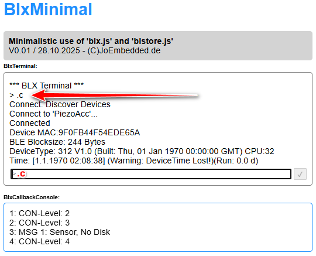

# BlxMinimal



**Live Demo:** [https://joembedded.github.io/BlxMinimal/](https://joembedded.github.io/BlxMinimal/)

## Description

This program is a minimal usage example of `blx.js` and `blstore.js`. For the easiest possible use, the compacted versions of the scripts are utilized. The current versions can be obtained from `blxdash/dist/...`. Upon request, the scripts are also available in source code form.

This demo contains the 'essentials' of the [BlxDashboard](https://github.com/joembedded/ltx_ble_demo).

> It is recommended to use/develop with this software under VS Code with >the "Live Server" extension (Ritwick Dey).

## Usage

Using the command line interface, you can connect to LTX devices or OSX nodes via BLE (provided the browser supports Bluetooth Web API). 

> All BLX commands are listed in Docu/blx_commands.txt (but the device or sensor has a bunch of additionals comands too).

### Connecting to a Device

The simplest command to establish a connection is:
```
.c
```
or
```
.connect
```

### PIN Authentication

Some devices require a PIN. This must be entered once using:
```
.i PIN
```

The PIN will then be automatically saved in the browser's IndexDB (by `blstore.js`) for future connections.

## Requirements

- A browser with Bluetooth Web API support or (e.g. for iOS a 'Sandbox' with BLE Web API wrapper)
- HTTPS connection (required for Web Bluetooth API)

## Files

- `blx.js` - BLE communication library
- `blstore.js` - IndexedDB storage library
- `index.html` - Main application interface
    
  ***
